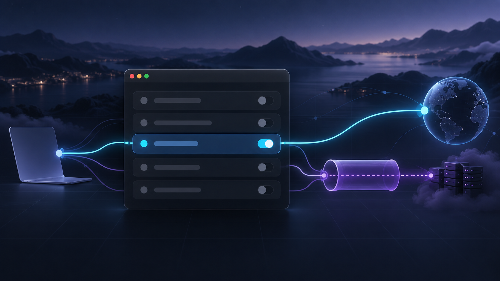
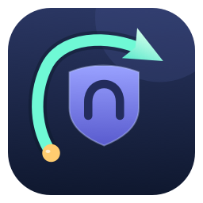

**English** | [Русский](README.ru.md)

<p align="center"></p>
<p align="center"></p>
<h1 align="center">Direct Sites</h1>
<p align="center"><strong>Selected sites outside your VPN. Other traffic follows its normal route.</strong></p>
<p align="center">A native macOS utility with domain and subdomain rules for browsers and IP exceptions for other applications.</p>
<p align="center"><a href="https://github.com/hardcodd/direct-sites/releases/latest">Download for macOS</a> · <a href="CHANGELOG.md">Changelog</a> · <a href="SPECS.md">Specification</a> · <a href="LICENSE">MIT License</a></p>

## Why Direct Sites

| Capability | Behavior |
| --- | --- |
| Domain rules | `example.com` covers its subdomains, including `api.example.com`, without matching unrelated domains. |
| VPN remains the default | Unmatched traffic follows normal system routing, including an active VPN. The system default route is unchanged. |
| Native implementation | Swift/AppKit without third-party libraries. TLS is relayed without decryption or installed certificates. |
| Other applications | IP exceptions provide direct host routes with background checks. |

The interface supports English and Russian. Saved rules and background services continue working after you close the window.

## Requirements and installation

- Apple Silicon Mac. The build targets macOS 14+ and has been tested on macOS 27. Intel and older macOS versions remain unverified.
- Administrator authorization to install, change rules, configure system proxies or remove services.
- Browsers that honor macOS HTTP/HTTPS proxy settings. System mode targets Safari, Chrome, Yandex and Firefox; compatibility needs verification in each browser version.
- A VPN that permits connections through the physical interface. A strict kill switch may block them.

The published `Direct-Sites-v0.4.0-macOS-arm64.zip` includes system proxy mode, rule-list navigation and bulk clearing, while retaining Firefox PAC and the Chrome extension. Extract the archive and move **Direct Sites.app** to **Applications**. It is ad-hoc signed, without Apple Developer ID signing or notarization. macOS may block its first launch. If you trust the source and archive, use the macOS Privacy & Security approval flow or build the application yourself.

Opening the window does not install services. **Apply** installs them through the system administrator prompt. The application never receives or stores your password.

## Browsers: domains and subdomains

### Finding and organizing rules

Use the search field or **⌘F** to find names, domains and IP addresses. Paste a full URL to search its host; Unicode domain spelling, resolved IPs and observed browser hosts are searchable too. Multiple words narrow the results. **Escape** clears the query, and **Reset** clears both the search and rule filter.

Sort by address, name or original order, and use the arrow to reverse it. Filter browser rules, IP routes or rules needing attention. Groups can be collapsed by type, organized under related configured domains, or removed entirely. Related-domain groups use existing parent rules; unrelated domains remain together. Search temporarily expands matching groups. Grouping, sorting, filters and collapsed groups are remembered on this Mac; they do not reorder stored rules or change routing. Edit and removal always target the selected rule, including after sorting or searching.

To remove every domain and IP address at once, choose **Clear list…**, confirm, then choose **Apply**. This includes rules hidden by search, filters or collapsed groups. Cancel keeps the list intact; clearing keeps the services and system proxy mode installed.

### Add a rule

1. Choose **Add site**, enter a domain and a friendly name.
2. Keep **Domain and all subdomains — browser mode** enabled.
3. Choose **Apply** and authorize the change.

### Shared system mode

1. Choose **Enable system proxy**. The app applies the current list and updates services, then sets HTTP/HTTPS proxies to `127.0.0.1:17879` on enabled physical Ethernet/Wi-Fi services and the primary registered network service, including a VPN. macOS requests administrator authorization.
2. Safari, Chrome and Yandex use system settings unless an extension or policy overrides them. Disable the previous Direct Sites Chrome extension and other proxy overrides.
3. In each Firefox profile, open the connection/proxy dialog in **Settings** and choose **Use system proxy settings** instead of the previous PAC URL. In newer layouts it is under **Privacy and security → Connection and software security → Configure proxy**; older layouts offer **Network Settings** in **General**. Settings search may not find this panel.
4. With your VPN active, check a listed site, its subdomain and a site outside the list. Configured proxy status does not establish website availability.

Previous preferences are saved in a root-only recovery file. **Disable system proxy** restores them while preserving unrelated network preferences and IP routes. Service removal restores system proxies first. While enabled, the background monitor restores cleared or disabled proxy settings after network changes, with a five-second fallback check. Slow route/DNS operations can delay a check. Newly selected registered services are backed up before configuration. An active foreign proxy reports a conflict and retains the recovery data. Explicitly disabling system mode stops automatic restoration before restoring saved preferences, even if that restoration fails. If a VPN has no persistent macOS service, system mode reports that it is unsupported.

System mode also affects other applications that honor macOS proxies. SSH and software that ignores them continue using IP exceptions. It temporarily disables system SOCKS, PAC and auto-discovery and replaces proxy exceptions with local destinations (`localhost`, `*.localhost`, `127.*`, `::1`, and simple hostnames). Previous values return on disable. The proxy settings and proxy protocol enablement of the primary registered service, including a VPN, are also configured and restored. VPN server, tunnel configuration and the default route remain unchanged. If the local service is unavailable, applications may lose website access; disable system mode to recover previous preferences.

The following legacy options remain available for individual browsers and are unnecessary in system mode.

### Legacy Firefox PAC

1. Choose **Legacy Firefox PAC…** to copy the PAC URL.
2. Open Firefox connection settings, note the previous mode, select **Automatic proxy configuration URL** and paste:

   ```text
   http://127.0.0.1:17879/proxy.pac
   ```

3. Firefox must send destination names through SOCKS5. Enable **Proxy DNS when using SOCKS v5** if available; some Firefox versions hide it in PAC mode.

### Legacy Chrome extension

1. Choose **Legacy Chrome extension…**. The app copies the bundled extension into your Application Support directory and copies its folder path.
2. Open the extension manager from the dialog. Enable **Developer mode**, then **Load unpacked**.
3. In the folder picker, press **Command-Shift-G**, paste the path and choose the folder. Chrome requests permission for the extension to manage proxy settings.
4. Enable **Direct Sites for Chrome** in each profile that needs it. After updating the app, run extension setup again, then choose **Reload** on its extension card.

The extension configures only its Chrome profile; it does not change macOS proxies. An unavailable local service may interrupt browser access. Disable the extension before removing the service.

Open a listed site, then select its rule in Direct Sites. Details show hostnames for which direct connections were established. For example, `beget.com` covers `cp.beget.com` and `api-cp.beget.com`. Add external authentication domains separately. `example.com` does not cover `example.com.other.org`.

Configured browser traffic passes through the local service. Matching destinations connect through Ethernet/Wi-Fi; others use normal system routing, including the VPN. Local destinations bypass the proxy.

TCP, HTTPS and WSS are supported. SOCKS UDP/QUIC is unsupported. TLS is not decrypted and no certificates are installed. DNS follows system settings; DNS VPN bypass is not guaranteed.

**Disable system mode before stopping the service. For legacy browser setup, restore Firefox's previous proxy mode and disable the Chrome extension.** Closing the GUI is safe: services run independently.

## IP exceptions for other applications

Add an IP or exact domain and turn off the subdomain option. Numeric addresses always use route mode. The helper resolves domains into IPv4/IPv6 addresses and creates host routes through the physical gateway without changing the default route.

Exceptions cover the whole IP, including other sites sharing it. Subdomains are not automatically included. CDN addresses may differ between browser and helper DNS responses, so route mode cannot cover every website.

Routes are checked every 30 seconds. DNS failure preserves previously resolved addresses. Network changes and VPN reconnections are handled on the next successful pass; slow operations can extend the interval. Missing direct IPv6 gateways are reported.

Existing manual routes remain external: the app never adopts or deletes them. Removing a rule removes only owned routes whose current parameters still match the recorded values. Shared IPs remain while another rule needs them. Figma and terminal IP exceptions operate independently of system proxy mode.

## Rules and status

Input accepts domains, HTTP(S) URLs and IP addresses. Only a URL's host is retained. Names can be edited; an empty name defaults to the domain. Favicons are discovered in the site's home page and then at `/favicon.ico`. Browser rules fetch icons through the local SOCKS proxy. Successful images are cached and displayed during outages; updates are checked on the next GUI launch. Failed requests retry with increasing delays while the window is open. Missing icons use the default symbol. IP rules do not fetch icons. Page titles are not extracted.

Rule changes take effect after **Apply**. Applying restarts the proxy and may interrupt connections. **Direct** confirms a route; **Ready for browsers** confirms local service availability. Neither guarantees successful website loading or login.

## Background services and data

| Component | Purpose |
| --- | --- |
| `app.directsites` | Root service for host routes and background system proxy maintenance |
| `app.directsites.browser` | HTTP/HTTPS and SOCKS5 proxy running as `nobody` |
| `/Library/Application Support/DirectSites/` | Helper copy, `rules.json`, `state.json`, proxy recovery journal, mode marker and lock |
| `/Library/LaunchDaemons/` | Two launchd jobs |
| `127.0.0.1:17879` | Proxy listener, `/proxy.pac` and `/status` |

Services start automatically at boot; real reboot recovery remains unverified. Moving or deleting the GUI bundle does not remove its installed helper. Applying a newer version replaces validated legacy jobs while preserving rules and owned routes.

Rules and route state are readable by local users and writable by the administrator. The proxy recovery file is root-only. The listener binds only to loopback but is available to other processes and users without authentication; it is not a local-account isolation boundary. `/status` retains counters and up to 100 matched hostnames in memory, without URL paths or passwords.

## Removal

1. Disable system mode. Switch legacy PAC profiles to system settings and disable the Chrome extension. Service removal also restores system preferences automatically.
2. Choose **Remove service…** and confirm.
3. After successful removal, delete the application from Applications.

Both services, saved rules and owned routes are removed. External routes remain. Retry after cleanup errors; an empty directory containing the lock file may remain.

## Build from source

Requires macOS, Apple Command Line Tools with Swift 6, `iconutil`, `codesign` and [RTK](https://github.com/rtk-ai/rtk). Verified toolchain: Swift 6.4 and macOS SDK 27.0. RTK is needed by the build script, not by end users.

```sh
rtk zsh build.sh
```

The script runs contract and proxy protocol tests, builds the arm64 GUI and helper with warnings as errors, generates the icon, signs the bundle and verifies its signature. Outputs: `Direct Sites.app` and `Direct Sites.zip`; intermediates reside in `$TMPDIR/DirectSitesBuild`. Build in a normal local environment: sandbox restrictions may prevent `iconutil` from working.

To verify an archive, extract it into a local temporary directory and run `codesign --verify --deep --strict` on the app. Cloud directories may introduce extended attributes that affect signature verification.

| Source | Responsibility |
| --- | --- |
| `Source/App.swift` | Window, rules, authorization and favicons |
| `Source/ChromeSetup.swift`, `ChromeExtension/` | Legacy Chrome extension setup and source |
| `Source/Core.swift` | Models, input validation, gateways and storage |
| `Source/RuleList.swift`, `Source/RuleListTests.swift` | Search, filters, sorting, group projection and navigation contracts |
| `Source/Helper.swift` | Installation, route checks and removal |
| `Source/Migration.swift` | Validated legacy service discovery |
| `Source/BrowserProxy.swift` | HTTP/HTTPS, SOCKS5, relay and local endpoints |
| `Source/HTTPProxy.swift`, `Source/ProxyTests.swift` | HTTP parser and protocol tests |
| `Source/SystemProxy.swift` | System proxy ownership and preference recovery |
| `Source/ProxyRouting.swift` | PAC, domain matching and connection counters |
| `Source/Tests.swift` | Core and proxy preference contract tests |
| `Source/Icon.swift` | AppKit icon generation |

Tests cover normalization, invalid input, gateways, shared IPs, DNS cache, foreign route protection, domain boundaries, old configuration decoding, legacy service discovery, user-local extension setup, HTTP/CONNECT parsing, local endpoint protection, missing configuration errors and managed preference recovery. They do not replace privileged integration tests, all four browser checks, IPv6, reboot, network changes or VPN compatibility testing.

## License

[MIT](LICENSE).
